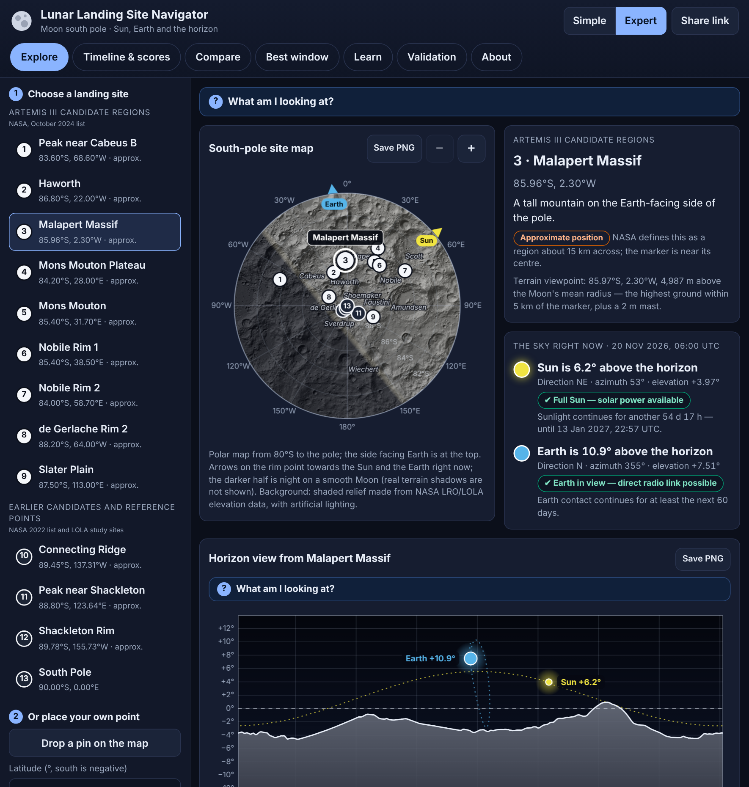

# Lunar Landing Site Navigator

**NASA Space Apps Challenge 2026 — challenge "Lunar Landing Site Navigator".**

Compare landing sites and dates near the Moon's south pole: see where the Sun and the Earth
sit against the real terrain horizon, when a site has solar power and a direct radio link to
Earth, and when and where it is best to land.

- **Live app:** https://factifyedka.github.io/lunar-naviagator/ (after GitHub Pages is switched on, see below)
- Static website: HTML, CSS and JavaScript only. No backend, no login, no CDN, no trackers.



## What it does
| Tab | What you get |
|-----|--------------|
| Explore | South-pole relief map with NASA's Artemis III candidate regions, custom pin, live horizon view with the real terrain skyline, time slider and time-lapse |
| Timeline & scores | Power / radio-contact timeline for 30 days to 1 year, five key numbers, an explainable overall score with weight sliders, whole-year ranking |
| Compare | Up to four sites or dates side by side |
| Best window | Enter a mission length; get the best start dates for one site or all sites |
| Learn | Six-step guided tour in plain language, glossary, tap-to-explain words |
| Validation | 22 live checks against NASA JPL Horizons, NASA LOLA illumination maps and known physics |
| About | Method, data credits, honest limitations, AI disclosure, references |

Every chart can be saved as PNG, every table as CSV, and every view shared by link.

## Data and method (short)
- Sun/Moon ephemeris: [astronomy-engine](https://github.com/cosinekitty/astronomy) (MIT), vendored in `vendor/`.
- Moon orientation: IAU WGCCRE rotation model.
- Terrain: NASA LRO/LOLA `LDEM_75S_240M` elevation model → horizon masks (`tools/build-terrain.mjs`).
- Validation references: NASA JPL Horizons and NASA LOLA average-illumination maps.
- Details and every approximation: [DECISIONS.md](DECISIONS.md). Roadmap: [PLAN.md](PLAN.md).

## Run and test
```
python3 -m http.server 8080      # then open http://localhost:8080
npm test                         # 29 automated tests (Node 20+, nothing to install)
node tools/browser-check.mjs     # headless click-through of every feature (needs Playwright)
node tools/simulate.mjs 2027     # full-year simulation of every site, prints a ranking
```

## Switch on GitHub Pages (owner, once)
1. Open the repository on github.com and tap **Settings**.
2. Tap **Pages** in the left menu.
3. Under "Build and deployment" choose **Deploy from a branch**.
4. Pick the branch that holds this code and the folder **/ (root)**, then tap **Save**.
5. Wait a minute or two and open the live link above.

## Submission material
[SUBMISSION.md](SUBMISSION.md) (form texts) · [DEMO.md](DEMO.md) (7-slide outline and 30-second video script)

## Credits
Terrain and reference data: NASA (LRO/LOLA team at Goddard Space Flight Center, PDS Geosciences
Node, JPL Solar System Dynamics). Candidate-region names: NASA Artemis III announcements.
Code written with the help of Claude, an AI model by Anthropic; see the About page for the
full AI disclosure. Licence of the vendored library: `vendor/astronomy.LICENSE.txt`.
